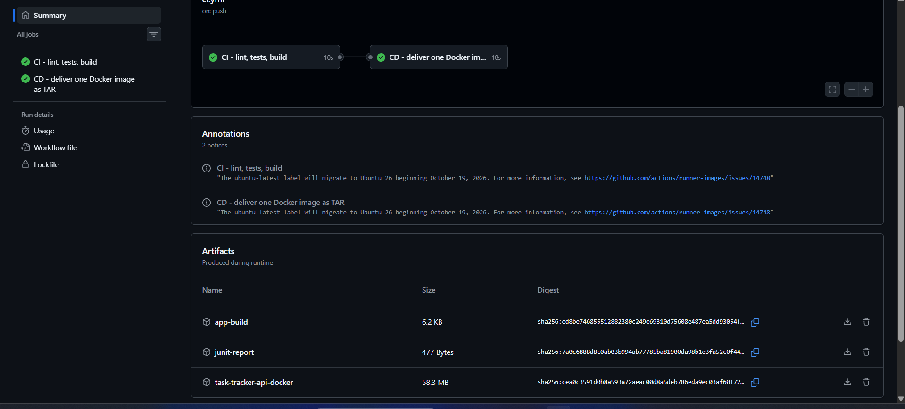

# Практична робота №7 — CI/CD на GitHub Actions

[](https://github.com/nez0x233/practical-7/actions/workflows/ci.yml)

**Рівень:** 75 балів  
**Проєкт:** Task Tracker  
**Стек:** Node.js 22, JavaScript, Docker, GitHub Actions

## Опис

Task Tracker — вебзастосунок для створення, перегляду, позначення виконаними та видалення завдань. Один Node.js-сервіс надає REST API та вебінтерфейс. Дані зберігаються в пам’яті процесу.

- Вебінтерфейс: `http://localhost:3000`
- Перевірка стану API: `GET http://localhost:3000/health`
- Завдання: `GET /api/tasks`, `POST /api/tasks`, `PATCH /api/tasks/:id`, `DELETE /api/tasks/:id`

## Локальний запуск і перевірка

Середовище: Node.js 22 або новіше. У корені проєкту:

```bash
npm ci
npm start
```

За замовчуванням застосунок працює на порту **3000**. Автоматичні перевірки:

```bash
npm run lint
npm test
npm run build
```

## CI — автоматична перевірка

Workflow: [`.github/workflows/ci.yml`](.github/workflows/ci.yml). Запускається після `push` і `pull_request`, а також вручну (`workflow_dispatch`).

CI виконує `checkout`, налаштування Node.js 22 із кешем npm, `npm ci`, перевірку коду (`lint`), **4 автоматичні тести** та збірку (`build`). Результати зберігаються як артефакти `junit-report` і `app-build`.

## CD — доставка одного сервісу

Обрано **варіант B: Artifact**. Після успішного CI у гілці `main` запускається задача `CD - deliver one Docker image as TAR`:

1. Збирається Docker-образ сервісу `task-tracker-api`.
2. Запущений контейнер перевіряється запитом `GET /health` на порту **3000**.
3. Образ зберігається у файлі `task-tracker-api.tar`.
4. Файл публікується як GitHub Actions artifact `task-tracker-api-docker` (строк зберігання — 14 днів).

## Результат

Успішний запуск CI/CD підтверджено в GitHub Actions: обидві задачі завершилися успішно, згенеровано артефакти `app-build`, `junit-report` і `task-tracker-api-docker`.

- **Репозиторій:** https://github.com/nez0x233/practical-7
- **CI/CD workflow:** https://github.com/nez0x233/practical-7/actions/workflows/ci.yml
- **Успішний запуск і Docker-артефакт:** https://github.com/nez0x233/practical-7/actions/runs/44139230694
- **Звіт із підтвердженням:** [docs/zvit-praktychna-7.md](docs/zvit-praktychna-7.md)


