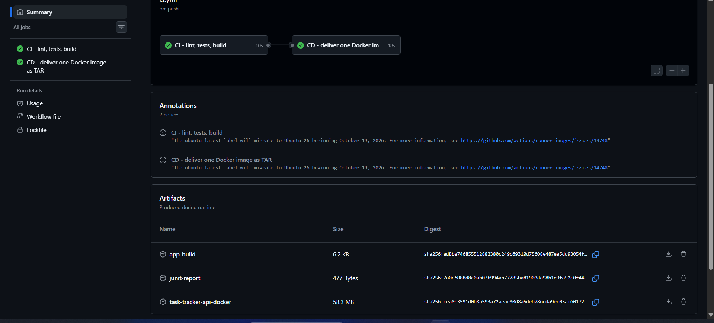

# Звіт з практичної роботи №7

**Тема:** CI/CD на GitHub Actions  
**Рівень виконання:** 75 балів  
**Проєкт:** Task Tracker  

## 1. Мета роботи

Налаштувати безперервну інтеграцію в GitHub Actions із перевіркою коду, запуском автоматичних тестів і збіркою застосунку. Реалізувати доставку одного сервісу у вигляді контейнерного артефакту.

## 2. Опис застосунку

Task Tracker — вебзастосунок на Node.js 22, який містить вебінтерфейс і REST API в межах одного сервісу. Користувач може створювати завдання, переглядати їх, змінювати статус виконання та видаляти. Дані зберігаються в пам'яті процесу. Стандартний порт застосунку — **3000**.

Основні маршрути API: `GET /health`, `GET /api/tasks`, `POST /api/tasks`, `PATCH /api/tasks/:id`, `DELETE /api/tasks/:id`.

## 3. Реалізація CI

Конфігурація зберігається у файлі `.github/workflows/ci.yml`. Налаштовано тригери `push`, `pull_request` і `workflow_dispatch`.

| Етап | Реалізація |
|---|---|
| Отримання коду | `actions/checkout@v7` |
| Середовище | `actions/setup-node@v7`, Node.js 22, кеш npm |
| Залежності | `npm ci` |
| Перевірка коду | `npm run lint` |
| Тести | `npm run test:ci`, 4 тести, JUnit XML |
| Збірка | `npm run build` |
| Артефакти | `junit-report`, `app-build` |

## 4. Реалізація CD

Обрано варіант B — **Artifact** для одного сервісу. Після успішного CI у гілці `main` GitHub Actions автоматично збирає Docker-образ `task-tracker-api`, запускає контейнер, перевіряє endpoint `/health` на порту **3000** та виконує `docker save` до файлу `task-tracker-api.tar`. Образ зберігається в GitHub Actions як артефакт `task-tracker-api-docker`.

## 5. Результати

На GitHub успішно завершилися обидві задачі першого запуску:

| Задача | Результат | Час |
|---|---|---:|
| CI — lint, tests, build | Успішно | 10 с |
| CD — deliver one Docker image as TAR | Успішно | 18 с |

Артефакти запуску:

| Артефакт | Розмір |
|---|---:|
| `app-build` | 6,2 КБ |
| `junit-report` | 477 байт |
| `task-tracker-api-docker` | 58,3 МБ |

**Репозиторій:** https://github.com/nez0x233/practical-7  
**Workflow:** https://github.com/nez0x233/practical-7/actions/workflows/ci.yml  
**Успішне виконання CI/CD і Docker-артефакт:** https://github.com/nez0x233/practical-7/actions/runs/44139230694

### Підтвердження виконання

*Рисунок 1 — успішне виконання GitHub Actions, завдання CI та CD і список артефактів.*

## 6. Висновок

Налаштовано автоматизовані перевірки коду, чотири тести та збірку застосунку в GitHub Actions. Реалізовано доставку одного сервісу через Docker-образ у форматі TAR. Успішне виконання CI/CD і публікацію артефактів підтверджено результатами GitHub Actions.
